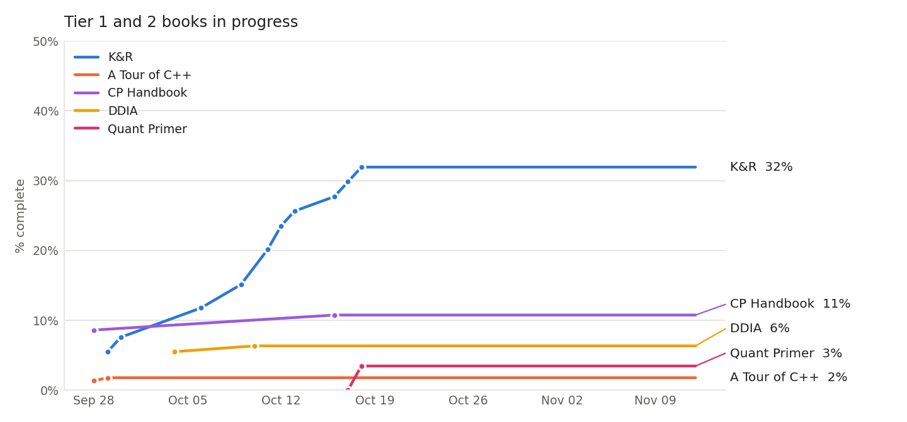

# ReadingList

Personal reading list across three tracks. Each track lives in its own file under `tracks/`.

| Track | File |
|---|---|
| Career progression | [tracks/career.md](tracks/career.md) |
| Competitive programming | [tracks/cp.md](tracks/cp.md) |
| Quant dev / quant research | [tracks/quant.md](tracks/quant.md) |

## Progress

<!-- progress:start -->
| Book | Progress | | Unit |
|---|---|---|---|
| K&R | `██████░░░░░░░░░░░░░░` | 32% | 76 of 238 pages |
| A Tour of C++ | `░░░░░░░░░░░░░░░░░░░░` | 2% | 4 of 226 pages |
| CP Handbook | `██░░░░░░░░░░░░░░░░░░` | 11% | 30 of 279 pages |
| DDIA | `█░░░░░░░░░░░░░░░░░░░` | 6% | 38 of 600 pages |
| Quant Primer | `█░░░░░░░░░░░░░░░░░░░` | 3% | 2 of 58 items |
<!-- progress:end -->

Data lives in [progress.csv](progress.csv). After logging, run `python3 scripts/plot_progress.py` to redraw the chart and this table.

## Goal: five books by December 31, 2027

Set 2026-10-17 as six books; the Putnam Guide moved out on 2026-11-12 (Putnam prep is tracked in its own repo). Finish these five before the end of 2027:

1. The C Programming Language (K&R)
2. A Tour of C++
3. Designing Data-Intensive Applications
4. Competitive Programmer's Handbook
5. An Interview Primer for Quantitative Finance

The chart above tracks all five.

## Priority order

### Tier 1

| | Title | Author | Track |
|---|---|---|---|
| [~] | The C Programming Language (2nd ed.) | Brian Kernighan, Dennis Ritchie | [quant](tracks/quant.md) |
| [~] | A Tour of C++ | Bjarne Stroustrup | [quant](tracks/quant.md) |
| [~] | Competitive Programmer's Handbook (draft, Aug 2019) | Antti Laaksonen | [cp](tracks/cp.md) |
| [~] | An Interview Primer for Quantitative Finance | Dirk Bester | [quant](tracks/quant.md) |

### Tier 2

| | Title | Author | Track |
|---|---|---|---|
| [~] | A Practical Guide to Quantitative Finance Interviews | Xinfeng Zhou | [quant](tracks/quant.md) |
| [~] | Designing Data-Intensive Applications (2nd ed.) | Martin Kleppmann, Chris Riccomini | [career](tracks/career.md) |
| [ ] | An Introduction to Statistical Learning with Applications in Python | James, Witten, Hastie, Tibshirani, Taylor | [quant](tracks/quant.md) |
| [ ] | The Theory of Poker | David Sklansky | [quant](tracks/quant.md) |

### Tier 3

Not a priority until the Tier 1 books are done.

| | Title | Author | Track |
|---|---|---|---|
| [ ] | Quant Job Interview Questions and Answers | Mark Joshi, Nick Denson, Andrew Downes | [quant](tracks/quant.md) |
| [ ] | Heard on the Street: Quantitative Questions from Wall Street Job Interviews | Timothy Falcon Crack | [quant](tracks/quant.md) |
| [ ] | Introduction to Mathematical Statistics (7th ed., 2012) | Robert V. Hogg, Joseph McKean, Allen T. Craig | [quant](tracks/quant.md) |
| [ ] | Python for Data Analysis (3rd ed.) | Wes McKinney | [quant](tracks/quant.md) |
| [ ] | Paul Wilmott on Quantitative Finance | Paul Wilmott | [quant](tracks/quant.md) |
| [ ] | Trading and Exchanges: Market Microstructure for Practitioners | Larry Harris | [quant](tracks/quant.md) |
| [ ] | Introduction to C++ for Financial Engineers: An Object-Oriented Approach | Daniel J. Duffy | [quant](tracks/quant.md) |
| [ ] | Computer Systems: A Programmer's Perspective (3rd ed.) | Randal Bryant, David O'Hallaron | [career](tracks/career.md) |

## Conventions

- `- [ ]` not started, `- [~]` in progress, `- [x]` done.
- Each item: **Title** by Author, tagged `(Tier N)`. One line on why it's on the list. Optional notes below it.
- Within a track, items are ordered by the sequence they should be read in.
- Keep the priority table above in sync when status changes.
