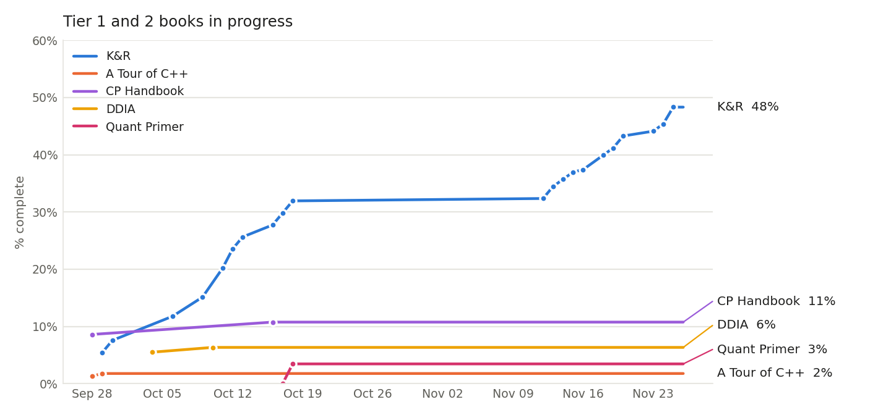

# ReadingList

What I'm reading to get better at systems programming, quantitative development and research, and high-performance computing. Every book in progress is logged by page and charted, so the list shows what has been read, not only what is planned.

## Progress

**[Open the interactive chart](https://sonok.github.io/ReadingList/)** to hover over any day and see what was read.

<!-- progress:start -->
| Book | Progress | | Unit |
|---|---|---|---|
| K&R | `██████████░░░░░░░░░░` | 49% | 117 of 238 pages |
| A Tour of C++ | `░░░░░░░░░░░░░░░░░░░░` | 2% | 4 of 226 pages |
| CP Handbook | `██░░░░░░░░░░░░░░░░░░` | 11% | 30 of 279 pages |
| DDIA | `█░░░░░░░░░░░░░░░░░░░` | 6% | 38 of 600 pages |
| Quant Primer | `█░░░░░░░░░░░░░░░░░░░` | 3% | 2 of 58 items |
<!-- progress:end -->

Data lives in [progress.csv](progress.csv) and dated entries in the [reading log](log.md). After logging, `python3 scripts/plot_progress.py` redraws the chart and this table.

## Tracks

| Track | Focus | Reading now |
|---|---|---|
| [Systems engineering](tracks/systems.md) | C and C++ from the memory model up, and what the machine does underneath | K&R, A Tour of C++ |
| [Quant dev](tracks/quant-dev.md) | C++ applied to trading: order books, concurrency, pricing code | TraderMath problems |
| [Quant trading / research](tracks/quant-research.md) | Probability, statistics, and markets | Quant Primer |
| [Tech](tracks/tech.md) | Algorithms and data systems | CP Handbook, DDIA |
| [HPC and ML inference](tracks/hpc.md) | Computer architecture, parallel and GPU programming, fast inference | CMSC411 in spring 2027 |

## Coursework

University of Maryland courses for spring 2027 that go with the tracks.

| Course | Title | Track |
|---|---|---|
| CMSC411 | Computer Systems Architecture | [HPC and ML inference](tracks/hpc.md) |
| CMSC764 / AMSC764 | Advanced Numerical Optimization (graduate) | [quant research](tracks/quant-research.md) |
| MATH611 | Combinatorics (graduate) | [quant research](tracks/quant-research.md) |

## Goal: five books by December 31, 2027

1. The C Programming Language (K&R)
2. A Tour of C++
3. Designing Data-Intensive Applications
4. Competitive Programmer's Handbook
5. An Interview Primer for Quantitative Finance

The chart above tracks all five.

## Priority order

### Tier 1: reading now

| | Title | Author | Track |
|---|---|---|---|
| [~] | The C Programming Language (2nd ed.) | Brian Kernighan, Dennis Ritchie | [systems](tracks/systems.md) |
| [~] | A Tour of C++ | Bjarne Stroustrup | [systems](tracks/systems.md) |
| [~] | Competitive Programmer's Handbook (draft, Aug 2019) | Antti Laaksonen | [tech](tracks/tech.md) |
| [~] | An Interview Primer for Quantitative Finance | Dirk Bester | [quant research](tracks/quant-research.md) |

### Tier 2: next

| | Title | Author | Track |
|---|---|---|---|
| [~] | A Practical Guide to Quantitative Finance Interviews | Xinfeng Zhou | [quant research](tracks/quant-research.md) |
| [~] | Designing Data-Intensive Applications (2nd ed.) | Martin Kleppmann, Chris Riccomini | [tech](tracks/tech.md) |
| [ ] | An Introduction to Statistical Learning with Applications in Python | James, Witten, Hastie, Tibshirani, Taylor | [quant research](tracks/quant-research.md) |
| [ ] | The Theory of Poker | David Sklansky | [quant research](tracks/quant-research.md) |
| [~] | Quant coding problems (50 problems) | TraderMath | [quant dev](tracks/quant-dev.md) |
| [ ] | Computer Architecture: A Quantitative Approach (6th ed.) | John Hennessy, David Patterson | [hpc](tracks/hpc.md) |

### Tier 3: later

| | Title | Author | Track |
|---|---|---|---|
| [ ] | Introduction to C++ for Financial Engineers: An Object-Oriented Approach | Daniel J. Duffy | [quant dev](tracks/quant-dev.md) |
| [ ] | Computer Systems: A Programmer's Perspective (3rd ed.) | Randal Bryant, David O'Hallaron | [systems](tracks/systems.md) |
| [ ] | Programming Massively Parallel Processors (4th ed.) | Wen-mei Hwu, David Kirk, Izzat El Hajj | [hpc](tracks/hpc.md) |
| [ ] | Performance Analysis and Tuning on Modern CPUs | Denis Bakhvalov | [hpc](tracks/hpc.md) |
| [ ] | Introduction to Mathematical Statistics (7th ed., 2012) | Robert V. Hogg, Joseph McKean, Allen T. Craig | [quant research](tracks/quant-research.md) |
| [ ] | Python for Data Analysis (3rd ed.) | Wes McKinney | [quant research](tracks/quant-research.md) |
| [ ] | Trading and Exchanges: Market Microstructure for Practitioners | Larry Harris | [quant research](tracks/quant-research.md) |
| [ ] | Paul Wilmott on Quantitative Finance | Paul Wilmott | [quant research](tracks/quant-research.md) |
| [ ] | Quant Job Interview Questions and Answers | Mark Joshi, Nick Denson, Andrew Downes | [quant research](tracks/quant-research.md) |
| [ ] | Heard on the Street: Quantitative Questions from Wall Street Job Interviews | Timothy Falcon Crack | [quant research](tracks/quant-research.md) |

## Conventions

- `[ ]` not started, `[~]` in progress, `[x]` done.
- Each item is tagged `(Tier N)` in its track file, with one line on why it is on the list and a status line once started.
- Within a track, items are in the order they should be read.
